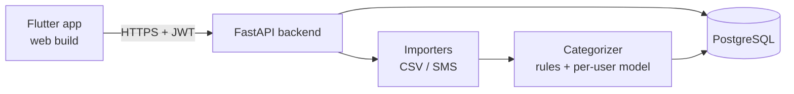

# Spendique

A personal expense tracker with bank-statement and SMS import, automatic categorization, and a spending dashboard. Built with a Flutter app and a FastAPI backend.

**Live demo:** https://spendique.netlify.app/
**API docs:** https://automated-expense-tracking-analytics-app.onrender.com/docs

> The backend runs on a free hosting tier that sleeps when idle, so the first load after a quiet period can take about a minute.

## Try it

1. Open the [live demo](https://spendique.netlify.app/) and sign up with any email (password of 8+ characters).
2. On the **Transactions** tab, add an entry manually, or tap the upload icon and import [`docs/sample_statement.csv`](docs/sample_statement.csv).
3. Open the **Dashboard** tab to see the charts.

## Features

- **Accounts:** sign up and log in with email and password (JWT auth, argon2 password hashing)
- **Transactions:** add, edit, delete, and filter by category and date range
- **Bank statement import:** upload a CSV; columns for date, description, and amount (or debit/credit) are detected automatically
- **SMS import:** paste bank/UPI SMS messages and they are parsed into transactions
- **Duplicate protection:** re-importing the same statement does not create duplicates
- **Auto-categorization:** keyword rules for common merchants, plus a small per-user model for merchants the rules don't know
- **Dashboard:** 30-day spend and income, income vs spending by month, category split, and top merchants
- **Data isolation:** every query is scoped to the logged-in user

## How it works



**Connecting to banks.** There is no public API for reading a person's UPI or bank history, so the app takes data in through CSV upload and pasted SMS. Both go through a common importer interface that outputs the same transaction object, so adding another source later means adding one importer.

**Categorizer.** Keyword rules cover common services (for example food delivery, ride hailing, shopping, and bills). For merchants the rules don't recognise, a small scikit-learn text model trained on the user's own past transactions suggests a category once there are enough labelled examples (20+ across at least two categories). Otherwise the transaction is left as "Uncategorized". Credits are labelled "Income". The model's accuracy has not been measured yet.

## Tech stack

| Layer | Tools |
|---|---|
| App | Flutter, Riverpod, Dio, fl_chart, flutter_secure_storage |
| Backend | Python, FastAPI, SQLAlchemy, Pydantic |
| Data / ML | PostgreSQL (SQLite for local dev), scikit-learn |
| Hosting | Render (backend, Docker), Neon (Postgres), Netlify (web build) |

## Project structure

```
.
├── backend/
│   ├── app/
│   │   ├── api/routes/     # auth, transactions, imports, insights
│   │   ├── core/           # settings, password hashing, JWT
│   │   ├── db/             # engine and session
│   │   ├── importers/      # CSV and SMS parsers
│   │   ├── models/         # SQLAlchemy tables
│   │   ├── schemas/        # Pydantic request/response models
│   │   ├── services/       # categorizer, insights
│   │   └── main.py
│   ├── Dockerfile
│   └── requirements.txt
├── mobile/                 # Flutter app
│   └── lib/
│       ├── core/           # API client
│       └── features/       # auth, transactions, dashboard, home
└── docs/                   # sample data, screenshots
```

## API overview

| Method | Endpoint | Description |
|---|---|---|
| POST | `/auth/signup` | Create an account |
| POST | `/auth/login` | Get an access token |
| GET | `/auth/me` | Current user |
| GET, POST | `/transactions` | List (with filters) or create |
| GET, PATCH, DELETE | `/transactions/{id}` | Read, update, or delete one |
| POST | `/import/csv` | Import a bank statement CSV |
| POST | `/import/sms` | Import pasted SMS messages |
| GET | `/insights` | Dashboard data |
| GET | `/health` | Health check |

Interactive docs are available at `/docs` when the backend is running.

## Running locally

**Backend**

```bash
cd backend
python -m venv venv
source venv/Scripts/activate      # Windows (Git Bash). On macOS/Linux: source venv/bin/activate
pip install -r requirements.txt
```

Create `backend/.env`:

```
DATABASE_URL=sqlite:///./expense_tracker.db
SECRET_KEY=<generate with: python -c "import secrets; print(secrets.token_hex(32))">
ACCESS_TOKEN_EXPIRE_MINUTES=60
```

```bash
uvicorn app.main:app --reload
```

The API is now at http://localhost:8000 and the docs at http://localhost:8000/docs.

**App**

```bash
cd mobile
flutter pub get
flutter run -d chrome        # or: -d edge
```

By default the app talks to `http://localhost:8000` (or `10.0.2.2:8000` on the Android emulator). To point it at a deployed backend:

```bash
flutter run -d chrome --dart-define=API_URL=https://your-backend.example.com
```

## Environment variables

| Variable | Purpose |
|---|---|
| `DATABASE_URL` | Database connection string (SQLite locally, Postgres in production) |
| `SECRET_KEY` | Secret used to sign JWTs |
| `ACCESS_TOKEN_EXPIRE_MINUTES` | Token lifetime (default 60) |
| `CORS_ORIGINS` | Comma-separated list of allowed web origins (default `*`) |

## Deployment

- **Backend:** Docker image deployed to Render, auto-deploying on push to `main`
- **Database:** Neon Postgres
- **Web app:** `flutter build web --release --dart-define=API_URL=<backend url>`, deployed to Netlify

## Known limitations

- SMS formats differ between banks. The parser handles common patterns, and messages it can't read are counted as skipped instead of guessed.
- The transaction list shows the latest 200 entries (no pagination yet).
- Database tables are created on startup; there are no migrations yet.
- The free hosting tier sleeps when idle, so the first request can be slow.
- Automated tests and CI are not set up yet.

## Roadmap

- [ ] Budgets and spending alerts
- [ ] "Ask your money" chat over your own data
- [ ] Privacy layer in front of the LLM (PII redaction, query guard, audit log)
- [ ] Account Aggregator integration (sandbox first)
- [ ] Anomaly detection for unusual spends
- [ ] Alembic migrations and pagination
- [ ] Android build

## Author

Built by [Anjali](https://github.com/Anjali875).
